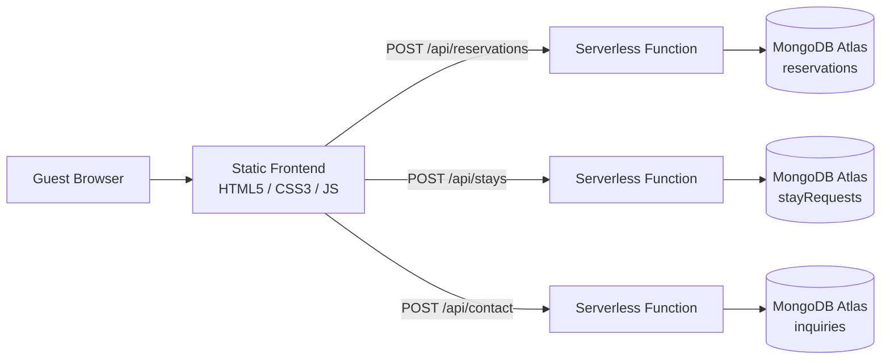

# LUMINA — Hotel & Dining

> Thoughtful stays and good things around the table.

[Live website](https://hotel-lumina-m.vercel.app/) · [GitHub repository](https://github.com/techprem324/hotel-lumina)

## Overview

LUMINA is a responsive hotel and dining website with separate pages for stays, the restaurant, venue spaces and contact details. Guests can request a room or reserve a dining table with a seating preference. Requests are stored in MongoDB Atlas and remain pending until the team confirms availability.

## Architecture



Guests select a room or table, enter their details and submit a request. The API returns a reference after MongoDB saves it. Requests are not confirmed until the LUMINA team checks availability and follows up. If MongoDB is unavailable or `MONGODB_URI` is missing, the API returns an error instead of showing a false confirmation.

## Pages

| Page | File | Features |
| :--- | :--- | :--- |
| Home | `index.html` | Curated introduction, room highlights, dining and booking links |
| Stay | `stay.html` | Room types, amenities and stay-request links |
| About | `about.html` | LUMINA story and hospitality principles |
| Book | `reserve.html` | Table reservations with seating choices and stay requests |
| Dining | `menu.html` | Searchable menu, category tabs and dietary filters |
| Spaces | `gallery.html` | Venue photography with lightbox viewer |
| Contact | `contact.html` | Inquiry form, concierge phone numbers and opening hours |

## API Reference

| Endpoint | Method | Input | Response |
| :--- | :--- | :--- | :--- |
| `/api/reservations` | `POST` | `name`, `email`, `phone`, `guests`, `date`, `time`, `seatingPreference`, `requests` | `{ success, bookingId, reservation }` |
| `/api/stays` | `POST` | `name`, `email`, `phone`, `roomType`, `checkIn`, `checkOut`, `guests`, `rooms`, `requests` | `{ success, bookingId, stayRequest }` |
| `/api/contact` | `POST` | `name`, `email`, `phone`, `subject`, `message` | `{ success, inquiryId }` |

Booking requests are saved with `status: "pending"`; no room or table inventory is claimed by this request form. Guest reservation records are not exposed through a public list endpoint.

## Setup

Requirements: Node.js 18 or newer and a MongoDB Atlas URI.

```bash
git clone https://github.com/techprem324/hotel-lumina.git
cd hotel-lumina
npm install
npm start
```

Set `MONGODB_URI` in the local environment (or Vercel project settings) for booking and inquiry submissions. Without it, forms return an explicit service-unavailable message. The local server runs on port `8123` by default.

```bash
npm test
npm run build
```

The build copies all pages and assets to `public/` (Vercel output) and `dist/`.

## Deployment

Vercel builds with `npm run build` and serves `public/`. Configure `MONGODB_URI` for the Production, Preview and Development environments where booking requests should be accepted.
